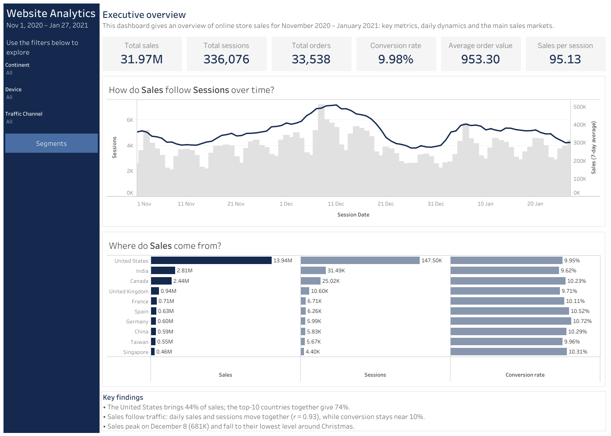
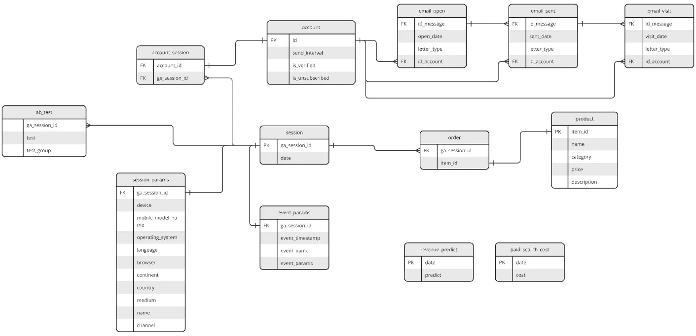

# Online Store Sales Analytics

End-to-end analysis of an online furniture store: data extraction with **SQL (BigQuery)**, exploratory and statistical analysis in **Python**, and an interactive **Tableau** dashboard.

## Interactive dashboard

[Open the dashboard on Tableau Public](https://public.tableau.com/app/profile/volodymyr.popeliastyi7905/viz/WebsiteAnalytics_17924856911650/Overview)

## Business questions

- Where do sales come from: which continents, countries and product categories?
- How do sales change over time, and what drives daily sales?
- Do traffic channels, devices and user groups differ in conversion?

## Data

- Source: the BigQuery dataset `data-analytics-mate.DA`. The [SQL query](sql/extract_sessions_orders.sql) joins 6 of its tables: `session`, `session_params`, `account_session`, `account`, `order` and `product`. Email, A/B test, event and cost tables are not used in this project.
- 349,545 sessions, 18 columns. After cleaning: 336,076 sessions, Nov 1, 2020 – Jan 27, 2021 (the last four days had no order records and were removed).
- One row = one session; a session contains at most one purchase.

## Tools

SQL (BigQuery) · Python (pandas, NumPy, SciPy, Matplotlib, seaborn) · Tableau Public

## Key findings

1. **Markets.** The Americas bring 55% of sales and the United States alone 44%; the top-10 countries give 74%.
2. **Products.** Sofas, chairs and beds bring 61% of sales. Bookcases have the most orders but a low average order (477 vs 1,950 for sofas).
3. **Conversion is stable.** About 10% of sessions end with a purchase in every channel, device and top country; the differences are not statistically significant.
4. **Sales follow traffic.** Daily sales and sessions are strongly correlated (r = 0.93). Sales peak on December 8, fall around Christmas and recover in January.
5. **Weekly cycle.** Tuesday to Thursday are 13–16% above the average day, weekends 20–26% below.

## Recommendations

- Grow traffic, since conversion is flat; plan campaigns and stock around the December peak and strong weekdays.
- Evaluate Paid Search by cost per visitor: it converts the same as Organic Search.
- Test site-wide conversion levers (checkout, prices, product pages), as conversion is the same in every segment.
- Promote high-ticket categories and add cross-sell to high-volume, low-price ones.

## Repository structure
~~~
├── data/
│ ├── sales_data.csv.zip # raw data extracted with SQL
│ └── tableau_data.csv # aggregated data for the dashboard
├── images/ # dashboard screenshots and database schema
├── notebooks/
│ └── portfolio_project_1.ipynb # analysis with outputs
├── sql/
│ └── extract_sessions_orders.sql
└── requirements.txt
~~~

## How to run

Click **Open in Colab** above and select **Runtime → Run all**. The notebook loads the data directly from this repository.

Locally: `pip install -r requirements.txt`, then open the notebook in Jupyter.
